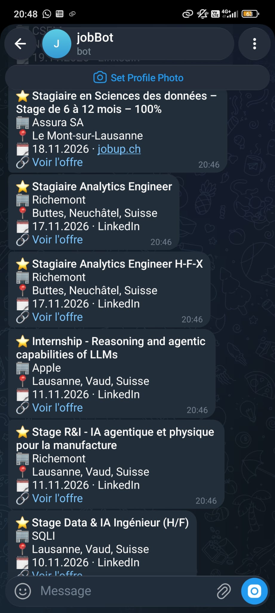

# InternshipHunter 🎯

Bot Python qui surveille les offres de stage autour de **Lausanne, Neuchâtel et Fribourg**,
garde uniquement celles de ton domaine et les envoie sur **Telegram**. Sous chaque offre, un
bouton donne des **conseils CV avec score ATS** ou un **brouillon de lettre de motivation**,
générés par Claude à partir de ton CV. Tourne gratuitement sur **GitHub Actions**.

<p align="center"></p>

## Fonctionnalités

- **Sources** : jobup.ch et jobs.ch (API JSON des sites), Adzuna (API officielle, optionnelle),
  LinkedIn (offres publiques, désactivé par défaut, voir plus bas).
- **Filtre « vrai stage »** : regex sur le titre (stage, stagiaire, internship, trainee), exclusion des
  apprentissages et stages de maturité (3+1, MPC).
- **Filtre de domaine** : mots-clés en mots entiers et sans accents (`IA` ne matche pas
  « stag**ia**ire », `IT` ne matche pas « dig**it**al »), préfixes avec `*` (`informati*`).
- **Dédoublonnage** : la même offre publiée sur plusieurs sites n'est envoyée qu'une fois, même si le
  titre varie (H/F, H-F-X, m/f/d, taux d'activité).
- **Mémoire SQLite** conservée entre deux passages via le cache GitHub Actions : jamais deux fois la
  même offre.
- **Robuste** : une source en panne n'arrête pas les autres ; alerte Telegram si toutes échouent ;
  limite de notifications par passage (le reste arrive au suivant).
- **Assistant candidature**, à la demande, uniquement pour les offres choisies :
  - 🎯 **Adapter mon CV** : note de correspondance, éléments à mettre en avant, mots-clés manquants,
    accroche, lignes à reformuler, et **score ATS estimé sur 100** (mots-clés, structure, lisibilité
    du texte brut du PDF) ;
  - ✉️ **Lettre** : brouillon dans la langue de l'annonce, format suisse.
  - Le modèle n'invente jamais d'expérience : ce qui manque est signalé, pas inventé.

## Architecture

```
GitHub Actions (cron) ──► python -m internship_hunter --once
                            │
                            ├─ 1. clics Telegram depuis le dernier passage (getUpdates)
                            │     └─ texte complet de l'annonce ─► Claude (CV + profil) ─► réponse
                            │
                            ├─ 2. sources ─► filtre stage ─► filtre domaine ─► dédoublonnage
                            │                                                 │
                            └─ 3. SQLite (déjà vu ?) ◄────────────────────────┘ ─► Telegram
```

| Module | Rôle |
|---|---|
| `internship_hunter/sources/` | un module par site (jobup / jobs.ch, LinkedIn, Adzuna) |
| `internship_hunter/filters.py` | filtre stage, exclusions, mots-clés de domaine, âge des offres |
| `internship_hunter/details.py` | texte complet d'une annonce |
| `internship_hunter/assistant.py` | prompts et appel à l'API Claude (CV en PDF, mise en cache) |
| `internship_hunter/telegram.py` | messages, boutons, découpage sous la limite de 4096 caractères |
| `internship_hunter/storage.py` | SQLite : offres vues, offset Telegram, demandes traitées |

## Installation

Il faut Python 3.10+ et un bot Telegram (envoie `/newbot` à **@BotFather**, puis `/start` à ton bot).

```bash
git clone https://github.com/XI-X-IX/InternshipHunter.git && cd InternshipHunter
pip install -r requirements.txt
cp .env.example .env                         # mets ton TELEGRAM_BOT_TOKEN
python -m internship_hunter --get-chat-id    # copie le TELEGRAM_CHAT_ID affiché dans .env
python -m internship_hunter --test           # message de test sur Telegram
python -m internship_hunter --dry-run        # affiche les offres trouvées, sans rien envoyer
python -m internship_hunter                  # recherche toutes les 30 minutes
```

Personnalise ta recherche en copiant `config.example.yaml` en `config.yaml` : villes, rayon,
mots-clés de domaine (`highlight_keywords`), `only_highlighted: true` pour ne recevoir que ton domaine.

### Sur GitHub Actions

> ⚠️ Ton CV et ton profil sont des données personnelles : fais-le tourner dans une **copie privée**
> de ce dépôt (GitHub → New → Import a repository, visibilité Private), jamais dans un fork public.

1. Secrets (**Settings → Secrets and variables → Actions**) : `TELEGRAM_BOT_TOKEN`,
   `TELEGRAM_CHAT_ID`, et en option `ADZUNA_APP_ID` / `ADZUNA_APP_KEY`, `ANTHROPIC_API_KEY`.
2. Active les passages planifiés en décommentant le bloc `schedule` de `.github/workflows/internship-hunter.yml`.
3. Le planificateur de GitHub peut sauter des passages : pour un déclenchement fiable, un service
   comme cron-job.org peut appeler l'API `workflow_dispatch` toutes les 30 minutes.

### Assistant CV et lettres

Ajoute `cv.pdf` (et éventuellement `profil.md`, voir `profil.example.md`) à la racine de ta copie
privée. Deux modes, choisis automatiquement :

- **Automatique** (secret `ANTHROPIC_API_KEY`) : la réponse arrive directement sur Telegram,
  quelques centimes par demande ; le CV est mis en cache entre les demandes.
- **Copier-coller** (sans clé) : le bot envoie un bloc prêt à coller dans un projet claude.ai qui
  contient ton CV, ton profil et les instructions de `claude_project_instructions.example.md`.

## Scraping responsable

jobup.ch, jobs.ch et LinkedIn n'ont pas d'API publique officielle : le bot utilise les mêmes requêtes
que leurs sites, avec peu de requêtes, des pauses et un intervalle de 30 minutes. Les conditions
d'utilisation de LinkedIn interdisent la collecte automatique : la source est donc **désactivée par
défaut** (`sources.linkedin` dans la config), à activer en connaissance de cause.

## Tests

```bash
pip install pytest
python -m pytest
```

Les parseurs sont testés sur des réponses enregistrées, les filtres sur des titres réels, le flux
complet (dédoublonnage, plafond de notifications, clics Telegram, mode copier-coller) avec Telegram
et l'API Claude simulés.

---

Projet réalisé par [Alexandra Dos Santos](https://me.axds.ch) pendant sa recherche de stage.
